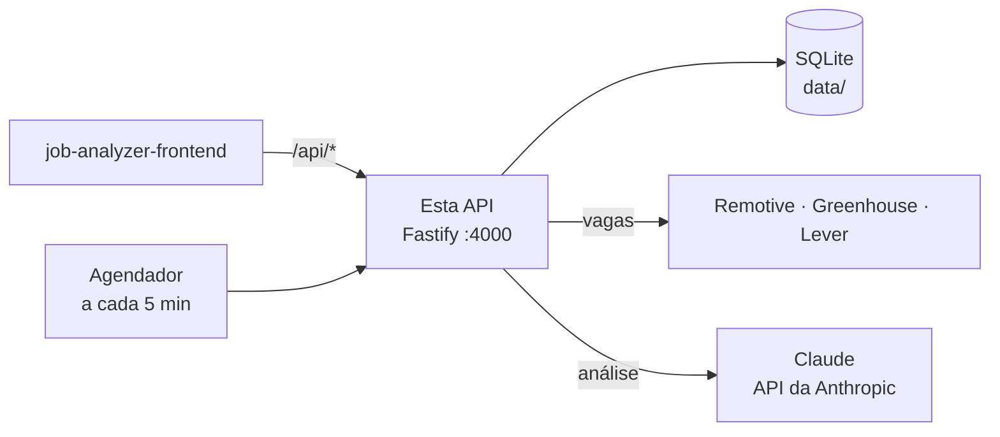
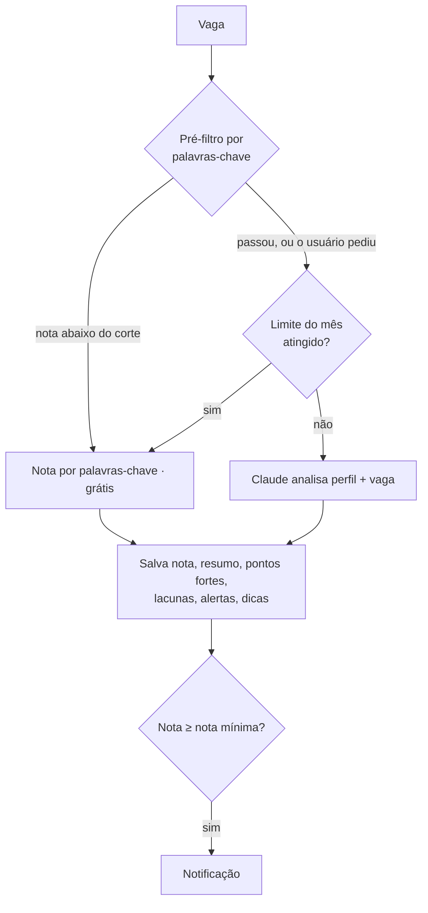

# Job Analyzer · Backend (API)

API do **Job Analyzer**, uma central de vagas que busca oportunidades, analisa cada uma com IA de acordo com o perfil do usuário e avisa só das que valem a pena.

Este repositório guarda **dados, regras e IA**. A interface fica no repositório **job-analyzer-frontend**, que conversa com esta API por HTTP em `/api/*`.

---

## Tecnologias

| Tecnologia | Para quê |
|---|---|
| **Node.js 22.5+** (testado no 24) | Ambiente de execução |
| **TypeScript** | Tipagem |
| **Fastify 5** | Servidor HTTP e rotas |
| **@fastify/cookie** | Cookie de sessão |
| **SQLite** (`node:sqlite`, embutido no Node) | Banco em arquivo, sem instalar nada |
| **Zod 4** | Validação das requisições e do formato da resposta da IA |
| **@anthropic-ai/sdk** | Chamada ao Claude (padrão: `claude-haiku-5-5`) |
| **tsx** | Roda TypeScript direto, com recarga automática em desenvolvimento |

---

## Arquitetura



### Camadas

```
routes/      → recebe a requisição, valida com Zod, checa login
   ↓
analyzer · sources · profile · usage · notify · scheduler   → regras de negócio
   ↓
db.ts        → SQLite
```

- **Autenticação:** a senha é guardada com `scrypt` e salt aleatório. O login cria uma sessão (token aleatório salvo no banco) enviada num cookie `httpOnly` válido por 30 dias. As rotas protegidas usam o `requireAuth`.
- **Fontes de vagas:** cada fonte é um módulo com a mesma interface (`JobSource`). Elas rodam em paralelo, e vagas repetidas são ignoradas pela chave única `(usuário, fonte, id externo)`.
- **Agendador:** sobe junto com a API e, a cada 5 minutos, roda a busca (e a análise, se ligada) para quem está no horário.

---

## Estrutura

```
src/
├── server.ts       sobe a API, registra as rotas, liga o agendador
├── config.ts       lê o .env e define os padrões
├── db.ts           conexão SQLite e criação das tabelas
├── auth.ts         senhas, sessões, requireAuth
├── profile.ts      perfil, % de preenchimento, texto enviado à IA
├── analyzer.ts     pré-filtro + análise com IA
├── usage.ts        custo por modelo e limites do mês
├── notify.ts       notificações (canais plugáveis)
├── scheduler.ts    busca/análise automática
├── sources/        remotive.ts, greenhouse.ts, lever.ts, index.ts
└── routes/         auth, profile, jobs, dashboard
data/               banco SQLite (criado ao rodar; fora do git)
```

---

## Como a análise funciona (`src/analyzer.ts`)



1. **Pré-filtro (grátis):** habilidades encontradas no texto (até 70 pontos; 5 já dão o máximo), +30 se o título bate com um cargo desejado (senão +10) e −25 por item de "não aceito". Abaixo de `AI_PREFILTER_MIN_SCORE`, a IA não é chamada. "Analisar de novo" e vagas coladas pulam essa etapa.
2. **Limite do mês:** acima de `AI_MONTHLY_MAX_ANALYSES` análises ou de `AI_MONTHLY_BUDGET_USD` de gasto, volta a ser só por palavras-chave até o dia 1º (`src/usage.ts`).
3. **IA:** o Claude devolve um JSON validado. O critério fica no `SYSTEM_PROMPT`: agir como recrutador técnico, pesar mais os requisitos obrigatórios, penalizar conflitos com o que o usuário não aceita, local, modelo de trabalho e salário. Escala: 85–100 combina muito, 70–84 boa, 45–69 em parte, 0–44 pouco. Roda com esforço `low`, a cerca de US$ 0,001 por vaga.

---

## Banco de dados

Arquivo `data/job-analyzer.db`, com as tabelas criadas sozinhas na primeira execução. Dá para abrir com o DBeaver.

| Tabela | Guarda |
|---|---|
| `users` | nome, e-mail, hash da senha |
| `sessions` | tokens de login e validade |
| `profiles` | perfil, fontes, nota mínima e automação |
| `jobs` | vagas e o status (nova, salva, candidatado, descartada) |
| `analyses` | nota, veredito, resumo, pontos fortes, lacunas, alertas, dicas |
| `ai_usage` | tokens e custo de cada análise com IA |
| `notifications` | avisos do usuário |

---

## API

Rotas sob `/api`. As marcadas com 🔒 exigem login (cookie de sessão).

| Método | Rota | O que faz |
|---|---|---|
| POST | `/auth/register` | Cria a conta e já entra |
| POST | `/auth/login` · `/auth/logout` | Entra · sai |
| GET | `/auth/me` | Usuário logado |
| DELETE 🔒 | `/auth/me` | Exclui a conta e os dados |
| GET · PUT 🔒 | `/profile` | Lê · atualiza o perfil (só os campos enviados) |
| GET 🔒 | `/jobs?filter=&q=` | Lista vagas e contagens |
| GET · PATCH · DELETE 🔒 | `/jobs/:id` | Detalhe · muda status · exclui |
| POST 🔒 | `/jobs` | Adiciona uma vaga colada e analisa |
| POST 🔒 | `/jobs/:id/analyze` | Analisa de novo |
| POST 🔒 | `/jobs/collect` | Busca vagas nas fontes |
| POST 🔒 | `/jobs/analyze-pending` | Analisa até 10 pendentes |
| GET 🔒 | `/dashboard` | Resumo, automação e uso da IA |
| GET 🔒 | `/sources` | Fontes e se estão configuradas |
| GET · POST 🔒 | `/notifications` · `/notifications/read` | Lista · marca como lidas |
| GET | `/health` | Verificação de saúde |

---

## Rodando

```bash
npm install
cp .env.example .env    # no Windows: copy .env.example .env  → coloque sua ANTHROPIC_API_KEY
npm run dev             # API em http://localhost:4000
```

| Script | O que faz |
|---|---|
| `npm run dev` | Sobe com recarga automática |
| `npm start` | Sobe sem recarga (produção) |
| `npm run typecheck` | Checa os tipos |

Sem `ANTHROPIC_API_KEY`, tudo funciona, mas a análise é só por palavras-chave.

## Variáveis de ambiente (`.env`)

| Variável | Padrão | Descrição |
|---|---|---|
| `PORT` | `4000` | Porta da API |
| `ANTHROPIC_API_KEY` | vazio | Chave da Anthropic (cobrada à parte do plano do Claude) |
| `ANTHROPIC_MODEL` | `claude-haiku-5-5` | Modelo da análise |
| `AI_MONTHLY_MAX_ANALYSES` | `500` | Máximo de análises com IA por mês |
| `AI_MONTHLY_BUDGET_USD` | `2` | Gasto máximo por mês, em dólares |
| `AI_PREFILTER_MIN_SCORE` | `30` | Nota mínima no pré-filtro para chamar a IA |
| `DATABASE_PATH` | `data/job-analyzer.db` | Caminho do banco |

---

## Segurança e privacidade

- Senhas com `scrypt` + salt e comparação em tempo constante.
- Cookie `httpOnly`, `sameSite=lax` (e `secure` em produção).
- Toda entrada é validada com Zod, e cada usuário só acessa as próprias vagas.
- Não pede senha do LinkedIn nem faz scraping. Vagas do LinkedIn entram coladas pelo usuário.
- **O perfil e o currículo são enviados à Anthropic** em cada análise com IA.
- `.env`, certificados e o banco ficam fora do git (veja o `.gitignore`).

## Como estender

| Quero... | Onde |
|---|---|
| Nova fonte de vagas | Arquivo em `src/sources/` implementando `JobSource` + linha em `sources/index.ts` |
| Notificar por Telegram/e-mail | Novo canal em `src/notify.ts` |
| Mudar o critério da IA | `SYSTEM_PROMPT` em `src/analyzer.ts` |
| Mudar o pré-filtro | `analyzeWithKeywords` em `src/analyzer.ts` |
| Nova rota | Arquivo em `src/routes/` + registrar em `server.ts` |
