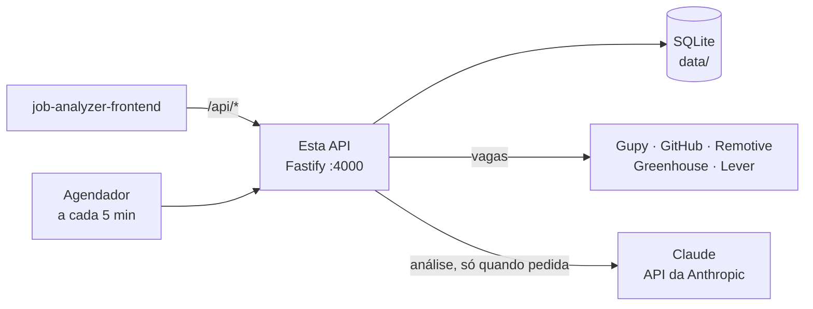
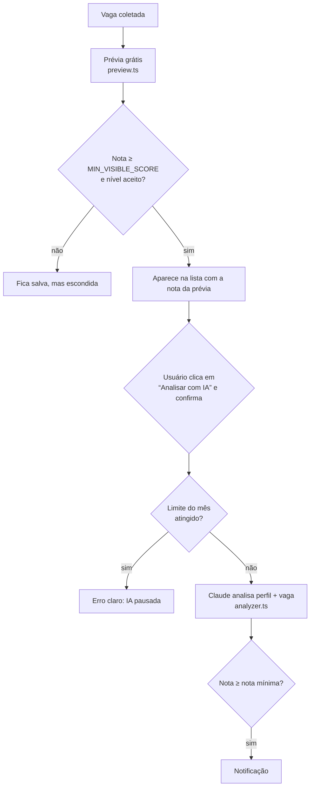

# Job Analyzer · Backend (API)

API do **Job Analyzer**, uma central de vagas que busca oportunidades brasileiras, dá a cada uma uma **nota grátis** de compatibilidade com o perfil do usuário e, **quando ele pede**, faz uma análise completa com IA.

Este repositório guarda **dados, regras e IA**. A interface fica no repositório **job-analyzer-frontend**, que conversa com esta API por HTTP em `/api/*`.

---

## Tecnologias

| Tecnologia | Para quê |
|---|---|
| **Node.js 22.5+** (testado no 24) | Ambiente de execução |
| **TypeScript** | Tipagem |
| **Fastify 5** | Servidor HTTP e rotas |
| **@fastify/cookie** | Cookie de sessão |
| **SQLite** (`node:sqlite`, embutido no Node) | Banco em arquivo, sem instalar nada |
| **Zod 4** | Validação das requisições e do formato da resposta da IA |
| **@anthropic-ai/sdk** | Chamada ao Claude (padrão: `claude-haiku-5-5`) |
| **tsx** | Roda TypeScript direto, com recarga automática em desenvolvimento |

---

## Arquitetura



### Camadas

```
routes/      → recebe a requisição, valida com Zod, checa login
   ↓
preview · seniority · analyzer · sources · profile · usage · notify · scheduler   → regras de negócio
   ↓
db.ts        → SQLite
```

- **Autenticação:** a senha é guardada com `scrypt` e salt aleatório. O login cria uma sessão (token aleatório salvo no banco) enviada num cookie `httpOnly` válido por 30 dias. As rotas protegidas usam o `requireAuth`.
- **Fontes de vagas:** cada fonte é um módulo com a mesma interface (`JobSource`), que devolve `{ jobs, warnings }`. Elas rodam em paralelo, e dentro de cada uma o `eachSafely` faz com que **um item com erro** (ex.: empresa que não existe) **não derrube os outros**: vira um aviso. Vagas repetidas são ignoradas pela chave única `(usuário, fonte, id externo)`.
- **Agendador:** sobe junto com a API e, a cada 5 minutos, roda a busca (e a análise com IA, se o usuário ligou) para quem está no horário.

---

## Estrutura

```
src/
├── server.ts        sobe a API, registra as rotas, liga o agendador
├── config.ts        lê o .env e define os padrões
├── db.ts            conexão SQLite, criação das tabelas e migrações
├── auth.ts          senhas, sessões, requireAuth
├── profile.ts       perfil, % de preenchimento, texto enviado à IA
├── preview.ts       prévia grátis: nota por palavras-chave e os matches
├── seniority.ts     detecção do nível da vaga e filtro de níveis aceitos
├── analyzer.ts      análise com IA (só quando pedida)
├── usage.ts         custo por modelo e limites do mês
├── notify.ts        notificações (canais plugáveis)
├── scheduler.ts     busca/análise automática
├── sources/         gupy.ts, github.ts, remotive.ts, greenhouse.ts, lever.ts,
│                    types.ts (contrato + utilitários), index.ts (registro)
└── routes/          auth, profile, jobs, dashboard
data/                banco SQLite (criado ao rodar; fora do git)
```

---

## Fontes de vagas

| Fonte | O que traz | Como busca |
|---|---|---|
| **Gupy** (`gupy.ts`) | Empresas brasileiras | Endereço do portal `portal.gupy.io` (não é API oficial: pode mudar) |
| **GitHub** (`github.ts`) | Vagas de tecnologia da comunidade (`backend-br/vagas`, `frontendbr/vagas`) | API oficial do GitHub (issues), sem chave, 60 requisições/hora |
| **Remotive** (`remotive.ts`) | Vagas remotas do mundo todo | API pública |
| **Greenhouse** / **Lever** | Sites de carreira das empresas cadastradas no perfil | APIs públicas dos boards |

Gupy, GitHub e Remotive usam as **palavras-chave** do perfil (Gupy e Remotive buscam com as **5 primeiras**). Greenhouse e Lever usam as palavras-chave e os cargos para **filtrar pelo título**.

Antes de adicionar uma fonte, confira: tem **API oficial**? O **`robots.txt`** permite? Os **termos de uso** permitem? Por isso LinkedIn e Catho ficam de fora.

---

## Como uma vaga é avaliada



### 1. Prévia grátis (`preview.ts`), em toda vaga, na hora da busca
- **Habilidades** encontradas no texto: até 70 pontos (5 encontradas já dão o máximo).
- **Cargo:** +30 se o título bate com um cargo desejado, senão +10.
- **Senioridade:** um nível acima do perfil, −20; dois ou mais, −40.
- **O que não aceito:** −25 por item encontrado.
- Abaixo de `AI_PREFILTER_MIN_SCORE`, a vaga é marcada como **pouco compatível** e nunca é analisada automaticamente.

### 2. Senioridade (`seniority.ts`)
- Detecta o nível pelo **título** (Estágio, Júnior/Jr, Pleno, Sênior/Sr, Especialista/Lead/Staff) e por **numeração** ("Analista II", "Engineer III"). Com dois níveis ("Pleno/Sênior"), fica com o **menor**.
- Sem nível no título, procura **anos de experiência** na descrição ("5+ anos", "3 years of experience").
- O usuário escolhe os **níveis que quer ver** (padrão: o nível dele e um acima). Vagas de outros níveis ficam escondidas. Vagas sem nível identificado sempre aparecem.

### 3. Visibilidade
Só aparecem vagas com nota a partir de `MIN_VISIBLE_SCORE` **e** com nível aceito. As outras ficam **salvas, mas escondidas**, para que a próxima busca não as traga de novo.

### 4. Análise com IA (`analyzer.ts`), só quando o usuário pede
- Disparada pela rota `POST /jobs/:id/analyze` (o frontend pede confirmação antes) ou pela análise automática, se ligada, e só nas vagas acima do corte e de nível aceito.
- O Claude devolve um JSON validado. O critério fica no `SYSTEM_PROMPT`: agir como recrutador técnico, pesar mais os requisitos obrigatórios, tratar a **senioridade como decisiva** e penalizar conflitos com o que o usuário não aceita, local, modelo de trabalho e salário.
- Escala: 85–100 combina muito, 70–84 boa, 45–69 em parte, 0–44 pouco. Roda com esforço `low`, a cerca de US$ 0,001 por vaga.
- Acima de `AI_MONTHLY_MAX_ANALYSES` análises ou de `AI_MONTHLY_BUDGET_USD` no mês, a IA fica pausada até o dia 1º (`usage.ts`).

---

## Banco de dados

Arquivo `data/job-analyzer.db`, com as tabelas criadas sozinhas na primeira execução e as **migrações** em `db.ts` (cada uma roda uma vez). Dá para abrir com o DBeaver.

| Tabela | Guarda |
|---|---|
| `users` | nome, e-mail, hash da senha |
| `sessions` | tokens de login e validade |
| `profiles` | perfil, fontes, nota mínima, automação e níveis aceitos (`accepted_levels`) |
| `jobs` | vagas, status, **prévia** (`preview_score`, `preview`) e **nível** (`seniority_level`) |
| `analyses` | só análises de **IA**: nota, veredito, resumo, pontos fortes, lacunas, alertas, dicas |
| `ai_usage` | tokens e custo de cada análise com IA |
| `notifications` | avisos do usuário |

---

## API

Rotas sob `/api`. As marcadas com 🔒 exigem login (cookie de sessão).

| Método | Rota | O que faz |
|---|---|---|
| POST | `/auth/register` | Cria a conta e já entra |
| POST | `/auth/login` · `/auth/logout` | Entra · sai |
| GET | `/auth/me` | Usuário logado |
| DELETE 🔒 | `/auth/me` | Exclui a conta e os dados |
| GET · PUT 🔒 | `/profile` | Lê · atualiza o perfil (só os campos enviados). Ao salvar, recalcula as prévias |
| GET 🔒 | `/jobs` | Lista paginada. Parâmetros: `filter` (`todas`, `melhores`, `nova`, `salva`, `candidatado`, `descartada`, `ia`), `q`, `company`, `page`, `pageSize`. Devolve também as contagens por situação e a lista de empresas |
| GET · PATCH · DELETE 🔒 | `/jobs/:id` | Detalhe (com prévia e análise) · muda status · exclui |
| POST 🔒 | `/jobs` | Adiciona uma vaga colada (recebe só a prévia) |
| POST 🔒 | `/jobs/:id/analyze` | Analisa a vaga com IA |
| POST 🔒 | `/jobs/collect` | Busca vagas nas fontes. Devolve novas, visíveis, escondidas e avisos |
| GET 🔒 | `/dashboard` | Resumo, automação e uso da IA |
| GET 🔒 | `/sources` | Fontes e se estão configuradas |
| GET · POST 🔒 | `/notifications` · `/notifications/read` | Lista · marca como lidas |
| GET | `/health` | Verificação de saúde |

---

## Rodando

```bash
npm install
cp .env.example .env    # no Windows: copy .env.example .env  → coloque sua ANTHROPIC_API_KEY
npm run dev             # API em http://localhost:4000
```

| Script | O que faz |
|---|---|
| `npm run dev` | Sobe com recarga automática |
| `npm start` | Sobe sem recarga (produção) |
| `npm run typecheck` | Checa os tipos |

Sem `ANTHROPIC_API_KEY`, tudo funciona, menos a análise com IA (a prévia grátis continua).

## Variáveis de ambiente (`.env`)

| Variável | Padrão | Descrição |
|---|---|---|
| `PORT` | `4000` | Porta da API |
| `ANTHROPIC_API_KEY` | vazio | Chave da Anthropic (cobrada à parte do plano do Claude) |
| `ANTHROPIC_MODEL` | `claude-haiku-5-5` | Modelo da análise |
| `AI_MONTHLY_MAX_ANALYSES` | `500` | Máximo de análises com IA por mês |
| `AI_MONTHLY_BUDGET_USD` | `2` | Gasto máximo por mês, em dólares |
| `AI_PREFILTER_MIN_SCORE` | `30` | Abaixo disso, a vaga é "pouco compatível" e nunca é analisada automaticamente |
| `MIN_VISIBLE_SCORE` | `20` | Abaixo disso, a vaga nem aparece (fica salva, escondida) |
| `DATABASE_PATH` | `data/job-analyzer.db` | Caminho do banco |

---

## Segurança e privacidade

- Senhas com `scrypt` + salt e comparação em tempo constante.
- Cookie `httpOnly`, `sameSite=lax` (e `secure` em produção).
- Toda entrada é validada com Zod, e cada usuário só acessa as próprias vagas.
- Não pede senha do LinkedIn nem faz scraping de sites que proíbem. Vagas do LinkedIn entram coladas pelo usuário.
- Nenhuma vaga vai para a IA sem o usuário pedir (ou ligar a análise automática).
- **O perfil e o currículo são enviados à Anthropic** em cada análise com IA.
- `.env`, certificados e o banco ficam fora do git (veja o `.gitignore`).

## Como estender

| Quero... | Onde |
|---|---|
| Nova fonte de vagas | Arquivo em `src/sources/` implementando `JobSource` (use `eachSafely`) + linha em `sources/index.ts` |
| Notificar por Telegram/e-mail | Novo canal em `src/notify.ts` |
| Mudar o critério da IA | `SYSTEM_PROMPT` em `src/analyzer.ts` |
| Mudar a nota grátis | `computePreview` em `src/preview.ts` |
| Mudar a detecção de nível | `detectJobLevel` em `src/seniority.ts` |
| Nova rota | Arquivo em `src/routes/` + registrar em `server.ts` |
| Mudar o banco | Nova migração em `src/db.ts` (veja o padrão `hasColumn`) |
